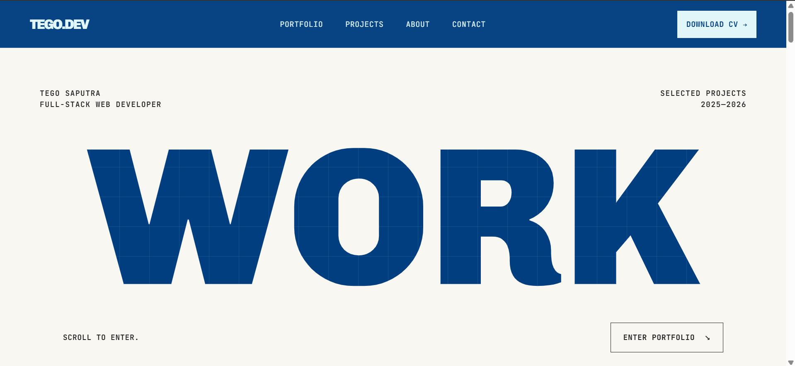
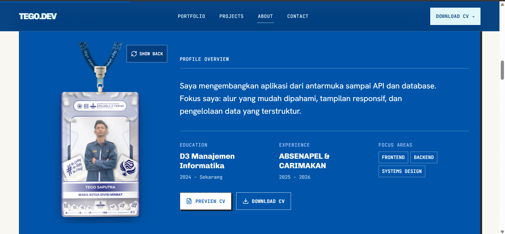

<p align="center">
  
</p>
<p align="center">
  
</p>

# TEGO.DEV — Portfolio

Portofolio Tego Saputra, Full-Stack Web Developer. Berisi profil, pilihan proyek, sertifikat, teknologi yang digunakan, CV, dan kontak.

## Menjalankan proyek

```bash
npm ci
npm run dev
```

Buka alamat lokal yang ditampilkan Vite. Form kontak dapat memakai Formspree melalui `VITE_FORMSPREE_ENDPOINT` di `.env.local`; jika tidak diatur, form membuka email yang sudah terisi. Contoh konfigurasi ada di `.env.example`.

## Pemeriksaan

```bash
npm run lint
npm run typecheck
npm run build
npm run test:smoke
npm run test:interactions
```

Dibuat dengan React, TypeScript, Vite, Motion, dan Lenis. Konfigurasi deploy Vercel tersedia di `vercel.json`.
